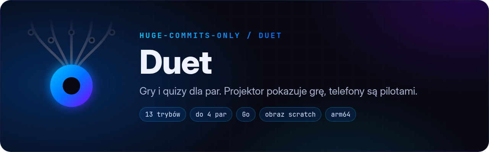
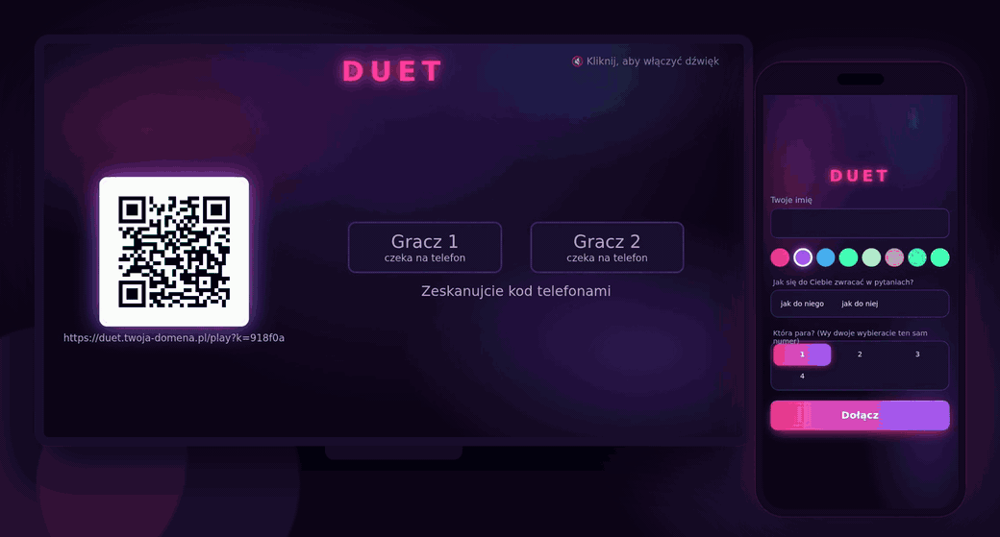

<p align="center">
  
</p>

<p align="center">
  <a href="../LICENSE"></a>
  <a href="https://github.com/Huge-Commits-Only/duet/actions/workflows/unit-test.yml"></a>
  <a href="https://scorecard.dev/viewer/?uri=github.com/Huge-Commits-Only/duet"></a>
  <a href="https://github.com/Huge-Commits-Only/duet/releases"></a>
  
</p>

<p align="center">
  
</p>

Projektor albo telewizor pokazuje grę, a telefony są pilotami: dołączacie, skanując kod QR. Gracie we dwoje albo z gośćmi, do czterech par przy jednym ekranie. Całość działa lokalnie w homelabie, bez kont i bez chmury.

## ✨ Funkcje
- Telefon jest padem: kolorowe przyciski w kształtach odpowiedzi z ekranu. Skanujesz kod QR i grasz, bez instalowania aplikacji, kont i logowania; można dodać Duet do ekranu początkowego.
- 14 trybów w trzech tonach, od „Co wolisz” przez Blef po rysowanie palcem: lekko, romantycznie, pikantnie (18+) albo wszystko naraz.
- Do czterech par przy jednym ekranie, z rankingiem najbardziej zgranej pary i botami do testów w pojedynkę.
- Profil pary: zgodność w ośmiu tematach, pytania do pogadania po grze i odznaki.
- Pamięć pary: pytania wracają po miesiącach, żeby sprawdzić, kto zmienił zdanie, a listy z kapsuły czasu otwieracie po roku.
- Statystyki wieczorów, lista wspólnych TAK i tajne stawki dla przegranych.
- Jeden plik binarny w Go, obraz `scratch`, około 25 MB RAM na Raspberry Pi.
- Testy w prawdziwej przeglądarce, fuzzing, CodeQL oraz podpisane obrazy i binarki.

## 🚀 Szybki start
```bash
docker compose pull && docker compose up -d
```
Otwórz `http://<adres-pi>:8080/screen` na projektorze i zeskanujcie kod QR telefonami. Bez Dockera: podpisana binarka z [Releases](https://github.com/Huge-Commits-Only/duet/releases). Domena, HTTPS, wersje i kopie zapasowe: [docs/instalacja.md](../docs/instalacja.md).

> [!WARNING]
> Gra nie ma logowania, więc trzymaj ją wyłącznie w sieci domowej. Kod w adresie z QR nie jest hasłem.

## 🎮 Tryby
| Tryb | O co chodzi |
|---|---|
| 🤔 Co wolisz | Oboje wybieracie jedną z dwóch opcji; liczy się zgodność |
| 👉 Kto prędzej… | Oboje wskazujecie, kogo z Was dotyczy pytanie |
| 🙊 Nigdy przenigdy | Oboje w tajemnicy: zdarzyło mi się albo nigdy. Ekran odsłania obie odpowiedzi |
| 💭 Jak dobrze mnie znasz | Jedno odpowiada o sobie, drugie zgaduje |
| 🎚️ Skala | Jedno ustawia suwak 0–100, drugie zgaduje jak najbliżej |
| 🔢 Szacowanie | Jedno podaje liczbę o sobie (np. ile razy w tygodniu…), drugie zgaduje jak najbliżej |
| 🔮 Telepatia | Oboje wpisujecie skojarzenie, punkt za to samo słowo |
| ✅ Wspólne TAK | Tak albo nie dla pomysłów; ekran pokazuje tylko to, na co oboje się zgodziliście, i zapisuje listę |
| 🕯️ Głębokie rozmowy | Karty do rozmowy na trzech poziomach głębi, bez punktów |
| 🎯 Wyzwania | Prawda albo zadanie dla jednej osoby, druga ocenia wykonanie |
| 🃏 Blef | Dwie prawdy i jedno kłamstwo; druga osoba szuka kłamstwa |
| 🎨 Rysowanie | Jedno rysuje palcem na telefonie, drugie zgaduje hasło w 60 sekund |
| 🎲 Wieczór mix | Gra sama przeplata tryby i liczy wspólny wynik |
| 🎂 Wieczór rocznicowy | Pytania z Waszej historii, z odpowiedziami sprzed miesięcy i listami z kapsuły czasu |

Masz pomysł na pytanie? [Zaproponuj je przez formularz](https://github.com/Huge-Commits-Only/duet/issues/new?template=pytanie.yml).

## 📚 Dokumentacja
| | |
|---|---|
| [Gra](../docs/gra.md) | Zrzuty, kilka par, boty, statystyki, stawka, wyłączanie pytań |
| [Instalacja i utrzymanie](../docs/instalacja.md) | Docker, binarki, przeglądarki, wersje, weryfikacja, kopie, Nginx Proxy Manager |
| [Własne pytania](../docs/pytania.md) | Format JSON i pola dla każdego trybu |
| [Rozwój](../docs/rozwoj.md) | Architektura, praca lokalna, CI/CD |

---

<p align="center"><sub>Część <a href="https://github.com/Huge-Commits-Only"><b>Huge Commits Only</b></a> · licencja <a href="../LICENSE">MIT</a></sub></p>
