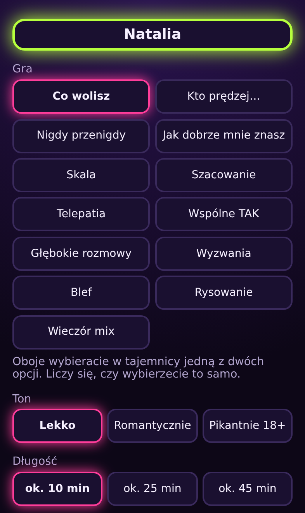
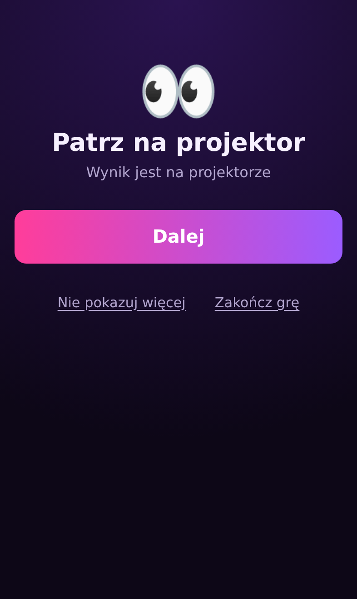

# 🎮 Gra

[← README](../.github/README.md)

<table>
<tr>
<td width="62%"></td>
<td width="19%"></td>
<td width="19%"></td>
</tr>
<tr>
<td align="center">Projektor czeka na graczy</td>
<td align="center">Menu na telefonie</td>
<td align="center">Wynik jest na projektorze</td>
</tr>
</table>

## Jak to działa
1. Na projektorze otwierasz `https://twoja-domena/screen` — pojawia się kod QR.
2. Oboje skanujecie kod telefonami, wpisujecie imię i wybieracie, jak się do Was zwracać („byłeś" czy „byłaś") — telefon to zapamięta. Dołączyć może tylko ktoś, kto ma adres z kodu QR.
3. Na telefonie wybieracie grę, ton (lekko / romantycznie / pikantnie 18+) i długość, a potem **Start**.
4. Odpowiadacie w tajemnicy na telefonach; projektor odsłania odpowiedzi i liczy zgodność.

Menu na telefonie ma na wierzchu tylko wybór gry, tonu i długości oraz przycisk Start; lista wspólnych TAK, statystyki, boty, zmiana imienia, gracze i kopia zapasowa są pod „Więcej". Ekran projektora dopasowuje się do każdej rozdzielczości i proporcji (16:9, 16:10, 4:3) — gdy treść się nie mieści, sam ją pomniejsza.

Rozmiar tekstu na projektorze zmienisz klawiszami `+` i `-` (`0` przywraca domyślny), a `m` wycisza dźwięk.

Dźwięk gra z urządzenia podłączonego do projektora. Dźwięk jest zawsze włączony na starcie, ale przeglądarka puści go dopiero po pierwszym kliknięciu lub klawiszu na ekranie projektora. Wyciszasz ikoną głośnika w prawym górnym rogu albo klawiszem `m`.

## Kilka par
Przy dołączaniu każdy wybiera numer pary (partnerzy ten sam). Gdy siedzą co najmniej dwie pary, ekran pokazuje ranking — wygrywa najbardziej zgrana para.

- **Wszyscy naraz:** Co wolisz, Kto prędzej…, Nigdy przenigdy, Jak dobrze mnie znasz, Skala, Szacowanie, Telepatia, Wspólne TAK. Każda para odpowiada między sobą na to samo pytanie.
- **Po kolei:** Wyzwania, Blef, Rysowanie. Jedna para gra, reszta patrzy na ekran; kolejka idzie wokół stołu, a gra jest odpowiednio dłuższa, żeby każdy miał tyle samo rund.
- **Wieczór mix** miesza jedne i drugie. **Głębokie rozmowy** są tylko dla jednej pary.

Pod przyciskiem „Więcej" na dole menu telefonu widać, kto siedzi w której parze, i można usunąć gracza, który zajął miejsce przez pomyłkę.

**Para 1 to domownicy.** Tylko ona widzi zapisaną listę wspólnych TAK, statystyki i kopię zapasową, i tylko wtedy, gdy nie siedzi nikt inny. Goście wybierają pary 2–4.

## Test w pojedynkę
Bez drugiej osoby też da się wszystko sprawdzić. Gdy siedzisz w parze sam, telefon pokazuje przycisk „Zagraj z botem" — bot zajmuje miejsce partnera i odpowiada losowo po krótkiej chwili. Z menu można jeszcze dosadzić parę botów, żeby zobaczyć ranking kilku par. Gry z botem nie liczą się do statystyk, a prawdziwy partner, który dołączy do Twojej pary, po prostu zastępuje bota.

## Statystyki
Każda dokończona gra trafia do historii. Przycisk „Pokaż statystyki na ekranie" w menu telefonu wyświetla na projektorze liczbę wieczorów i gier, średnią zgodność, wykres zgodności w ostatnich grach, zgodność w poszczególnych trybach, bilans zwycięstw i ostatnie wyniki.

## Stawka
Gdy gra jedna para, w grach z punktami każde z Was może przed startem wpisać tajną stawkę — co przegrany robi dla wygranego. Ekran odsłania stawkę zwycięzcy na końcu (przy remisie obie).

## Pytania, których nie chcecie
Pod każdym pytaniem na telefonie jest mały link **Nie pokazuj więcej**: pytanie znika ze wszystkich następnych gier (zapisuje się w `banned.json` w wolumenie). Działa tylko dla pary 1, czyli domowników.
