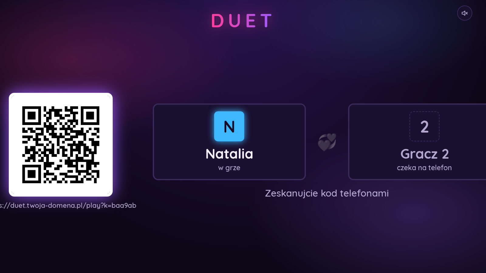

# 🎮 Gra

[← README](../.github/README.md)

<table>
<tr>
<td width="62%"></td>
<td width="19%"></td>
<td width="19%"></td>
</tr>
<tr>
<td align="center">Projektor czeka na graczy</td>
<td align="center">Menu na telefonie</td>
<td align="center">Wynik jest na projektorze</td>
</tr>
</table>

## Jak to działa
1. Na projektorze otwierasz `https://twoja-domena/screen`; pojawia się kod QR.
2. Oboje skanujecie kod telefonami, wpisujecie imię i wybieracie, jak się do Was zwracać („byłeś" czy „byłaś"), a telefon to zapamięta. Dołączyć może tylko ktoś, kto ma adres z kodu QR.
3. Na telefonie przesuwacie karty z grami, wybieracie ton (lekko / romantycznie / pikantnie 18+ / mieszany, czyli pytania ze wszystkich tonów) i długość, a potem **Start**.
4. Pytanie czytacie na projektorze. Telefon działa jak pad: duże przyciski mają ten sam kształt i kolor co odpowiedzi na ekranie (▲ ◆ ● ■), a pod spodem tekst odpowiedzi. Dopóki partner nie odpowie, możecie zmienić zdanie.
5. Gdy oboje odpowiecie, telefon odlicza 3-2-1 razem z projektorem i każe podnieść wzrok: wynik jest tylko na projektorze. Przy zgodnej odpowiedzi leci konfetti.

**Duet jak aplikacja:** w Safari stuknij Udostępnij i wybierz „Do ekranu początkowego”. Gra otwiera się wtedy na pełnym ekranie, bez paska Safari; telefon podpowiada to raz po dołączeniu. Na ekranie początkowym iPhone trzyma osobne dane, więc za pierwszym razem wpiszesz imię jeszcze raz.

Menu na telefonie ma na wierzchu karty z grami, ton, długość, przycisk Start i pod nim karty graczy; lista wspólnych TAK, statystyki, profil pary, wyciszenie dźwięków telefonu i kopia zapasowa są pod „Więcej". Po wyniku przycisk „Dalej” odblokowuje się po 5 sekundach, żeby nikt nie przeskoczył wyniku przed przeczytaniem. Ekran projektora dopasowuje się do każdej rozdzielczości i proporcji (16:9, 16:10, 4:3), a gdy treść się nie mieści, sam ją pomniejsza.

Rozmiar tekstu na projektorze zmienisz klawiszami `+` i `-` (`0` przywraca domyślny), a `m` wycisza dźwięk.

Dźwięk gra głównie z urządzenia podłączonego do projektora; telefony cicho klikają przy odpowiedzi i odliczaniu (wyciszysz je pod „Więcej”). iPhone nie pozwala grze w przeglądarce wibrować. Dźwięk jest zawsze włączony na starcie, ale przeglądarka puści go dopiero po pierwszym kliknięciu lub klawiszu na ekranie projektora. Wyciszasz ikoną głośnika w prawym górnym rogu albo klawiszem `m`.

## Kilka par
Przy dołączaniu każdy wybiera numer pary (partnerzy ten sam). Gdy siedzą co najmniej dwie pary, ekran pokazuje ranking: wygrywa najbardziej zgrana para.

- **Wszyscy naraz:** Co wolisz, Kto prędzej…, Nigdy przenigdy, Jak dobrze mnie znasz, Skala, Szacowanie, Telepatia, Wspólne TAK. Każda para odpowiada między sobą na to samo pytanie.
- **Po kolei:** Wyzwania, Blef, Rysowanie. Jedna para gra, reszta patrzy na ekran; kolejka idzie wokół stołu, a gra jest odpowiednio dłuższa, żeby każdy miał tyle samo rund.
- **Wieczór mix** miesza jedne i drugie. **Głębokie rozmowy** i **Wieczór rocznicowy** są tylko dla jednej pary.

Pod przyciskiem Start w menu telefonu są karty graczy: kolor, imię, stan (w grze, brak połączenia, bot) i para. Na swojej karcie zmieniasz imię i kolor (✏️), innych graczy usuwasz (✕), gdy ktoś zajął miejsce przez pomyłkę. Tam też usuwasz bota albo dodajesz parę botów.

**Para 1 to domownicy.** Tylko ona widzi zapisaną listę wspólnych TAK, statystyki, profil pary i kopię zapasową, i tylko wtedy, gdy nie siedzi nikt inny. Goście wybierają pary 2–4.

## Test w pojedynkę
Bez drugiej osoby też da się wszystko sprawdzić. Gdy siedzisz w parze sam, telefon pokazuje przycisk „Zagraj z botem". Bot zajmuje miejsce partnera i odpowiada losowo po krótkiej chwili. Z menu można jeszcze dosadzić parę botów, żeby zobaczyć ranking kilku par. Gry z botem nie liczą się do statystyk, a prawdziwy partner, który dołączy do Twojej pary, po prostu zastępuje bota.

## Statystyki
Każda dokończona gra trafia do historii. Przycisk „Pokaż statystyki na ekranie" w menu telefonu wyświetla na projektorze liczbę wieczorów i gier, średnią zgodność, wykres zgodności w ostatnich grach, zgodność w poszczególnych trybach, bilans zwycięstw i ostatnie wyniki.

## Profil pary
Pytania z trybów, w których oboje odpowiadacie na to samo (Co wolisz, Kto prędzej, Nigdy przenigdy, Jak dobrze mnie znasz, Skala, Szacowanie, Wspólne TAK), mają temat: codzienność, podróże, pieniądze i praca, przyszłość, rozrywka i znajomi, uczucia, charakter albo seks. Gra zapisuje każdą odpowiedzianą rundę domowników (`rounds.json` w wolumenie; gry z botem i z gośćmi się nie liczą).

- **Na koniec gry** projektor i telefony pokazują „Do pogadania”: do trzech pytań, w których Wasze odpowiedzi najbardziej się rozjechały.
- **„Pokaż profil pary na ekranie”** pod „Więcej” wyświetla zgodność w każdym temacie (od trzech pytań z tematu), zmianę w ostatnich 30 dniach (▲ albo ▼), najmocniejszy i najsłabszy temat, „Do pogadania” z ostatniego wieczoru, „Waszą historię” (kto zmienił zdanie przy pytaniu zadanym ponownie) i odznaki: serie zgodnych odpowiedzi, grę bez jednej różnicy, 10 wieczorów, wszystkie tematy i wszystkie tryby.

## Pamięć pary
Duet pamięta Wasze odpowiedzi, więc z czasem robi się ciekawszy:

- **Powtórki.** Raz na grę wraca pytanie, na które odpowiadaliście co najmniej dwa miesiące temu. Na telefonach i projektorze widać „🔁 To pytanie już było w marcu”, a przy wyniku projektor pokazuje, co każde z Was odpowiedziało wtedy. Pytanie o jedną osobę wraca do tej samej osoby.
- **Kapsuła czasu.** Na koniec pierwszej gry dnia (a potem w menu pod „Więcej opcji”) każde z Was może zostawić na telefonie jedno zdanie (do 200 znaków) do przeczytania za rok. Nikt go nie zobaczy wcześniej, także partner. Po roku w menu pojawia się przycisk „📬 Otwórzcie list sprzed roku”, który pokazuje listy na projektorze (`letters.json` w wolumenie).
- **Wieczór rocznicowy.** Tryb złożony wyłącznie z Waszej historii: najpierw pytania, przy których najbardziej się różniliście, potem te najdawniejsze, w kolejności, w jakiej padły pierwszy raz, każde z odpowiedziami sprzed miesięcy. Na koniec projektor pokazuje otwarte już listy z kapsuły. Potrzebuje co najmniej czterech pytań z Waszej historii i gra tylko jedna para, bez botów.
- **Wasz miesiąc.** Przy pierwszej grze w nowym miesiącu menu na projektorze podsumowuje poprzedni: wieczory, gry, średnią zgodność, temat, w którym byliście najbardziej zgodni, największą zmianę i nowe odznaki. Znika po „Zamknij podsumowanie miesiąca” albo po starcie gry.

## Stawka
Gdy gra jedna para, w grach z punktami każde z Was może przed startem wpisać tajną stawkę: co przegrany robi dla wygranego. Ekran odsłania stawkę zwycięzcy na końcu (przy remisie obie).

## Pytania, których nie chcecie
Pod przyciskiem ⋯ w rogu telefonu są **Pomiń rundę**, **Zakończ grę** i **Nie pokazuj więcej**. To ostatnie: pytanie znika ze wszystkich następnych gier (zapisuje się w `banned.json` w wolumenie). Działa tylko dla pary 1, czyli domowników. Gdy w nowej wersji gry poprawimy treść pytania, jego historia i ukrycie przechodzą na nową treść.
