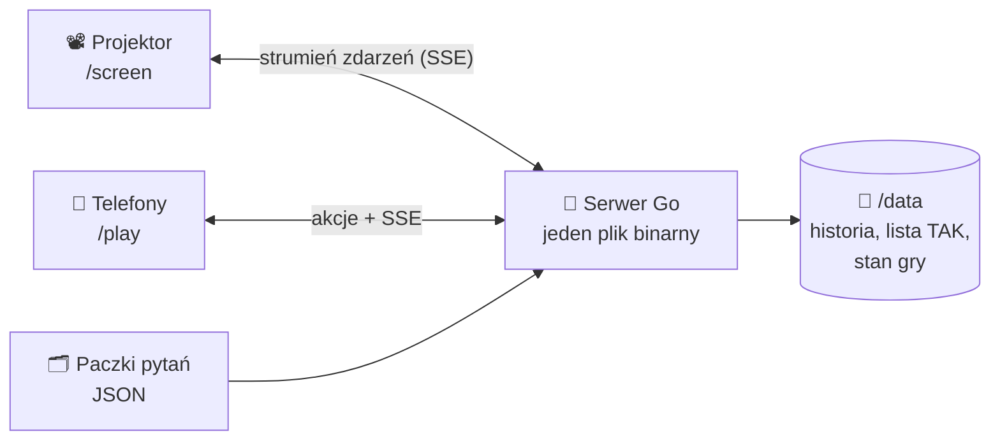

# 🛠️ Rozwój

[← README](../.github/README.md)

## Architektura



| Technologia | Rola | Szczegóły |
|---|---|---|
| 🎯 **Go** | Serwer | Jeden plik binarny, frontend wbudowany, ok. 25 MB RAM |
| 🌐 **HTML / CSS / JS** | Ekran i pilot | Bez frameworka i bez kroku budowania, zero zasobów z internetu |
| 🐳 **Docker** | Kontener | Obraz `scratch`, multi-arch (amd64 / arm64 dla Raspberry Pi) |
| 🔄 **GitHub Actions** | CI/CD | Testy, lint, skany bezpieczeństwa, publikacja obrazu |
| 📦 **GHCR** | Rejestr | `ghcr.io/huge-commits-only/duet` |

```
duet/
├── cmd/duet/            # punkt startowy programu
├── internal/
│   ├── game/            # gra: stan, tryby, punktacja, zapis (bez HTTP)
│   └── server/          # HTTP: strony, strumień zdarzeń, API dla telefonów
├── questions/           # paczki pytań, jeden plik JSON na tryb
├── web/                 # ekran projektora i pilot na telefon
├── e2e/                 # test w przeglądarce (Playwright)
├── docs/                # dokumentacja
├── .github/             # workflowy CI/CD, README i grafiki
├── Dockerfile
└── docker-compose.yml
```

## Praca lokalna
```bash
go vet ./... && go test ./...
DATA_DIR=./data PORT=18080 go run ./cmd/duet   # http://localhost:18080/screen

# test w przeglądarce: wszystkie tryby, projektor + dwa telefony
(cd e2e && npm ci && npx playwright install chromium)
go build -o bin/duet ./cmd/duet && ./e2e/run.sh
```

## CI/CD
| Workflow | Plik | Kiedy | Co robi |
|---|---|---|---|
| Go Verification | `go-test.yml` | PR, `main` | `go mod verify`, `go mod tidy -diff`, `gofmt`, kompilacja |
| Unit Test Verification | `unit-test.yml` | PR, `main` | `go test -race`, fuzzing akcji z telefonów i kopii zapasowej (po 30 s), podsumowanie pokrycia i próg minimalny (85%) |
| Lint Verification | `lint-test.yml` | PR, `main` | `golangci-lint` |
| Security Verification | `security-test.yml` | PR, `main` | `govulncheck` + Trivy (podatności, sekrety, konfiguracja) |
| CodeQL Verification | `codeql.yml` | PR, `main`, co tydzień | CodeQL `security-extended` dla Go, JS i workflowów; nowy alert o wadze wysokiej lub krytycznej blokuje merge |
| Container Verification | `container-test.yml` | PR | Buduje obraz, sprawdza czy kontener startuje, skanuje go Trivy |
| E2E Verification | `e2e-test.yml` | PR, `main` | Playwright: projektor i dwa telefony rozgrywają każdy tryb w prawdziwej przeglądarce |
| Workflow Verification | `workflow-test.yml` | PR, `main` | `actionlint` dla workflowów |
| PR Automation | `pr-automation.yml` | nowy PR | Przypisuje autora i reviewera, nadaje etykiety z nazwy brancha, ustawia milestone |
| Release Draft | `release-draft.yml` | `main` | Aktualizuje szkic notatek wydania |
| Docker Image Publish | `docker-build.yml` | `main` | Buduje obraz amd64 + arm64, publikuje do GHCR (`latest` + wersja) z podpisaną atestacją pochodzenia i SBOM |
| Scorecard Verification | `scorecard.yml` | `main`, co tydzień | OpenSSF Scorecard: ocena bezpieczeństwa łańcucha dostaw, wynik na scorecard.dev |

**Etykiety z nazwy brancha:** `feat/*`, `feature/*` → `enhancement` · `fix/*`, `bug/*` → `bug` · `docs/*` → `documentation` · `chore/*` → `chore` · `deps/*` → `dependencies`

**Ruleset na `main`:** tylko PR ze squashem, aktualna gałąź i wymagane checki: `Build & Modules`, `Go Tests`, `golangci-lint`, `govulncheck & Trivy`, `Trivy Image Scan`, `Playwright Game Run`, `Actionlint` i trzy joby `CodeQL`. Release Drafter zbiera PR-y od ostatniego *opublikowanego* wydania — nie usuwaj opublikowanych wydań, bo szkic będzie pusty.
